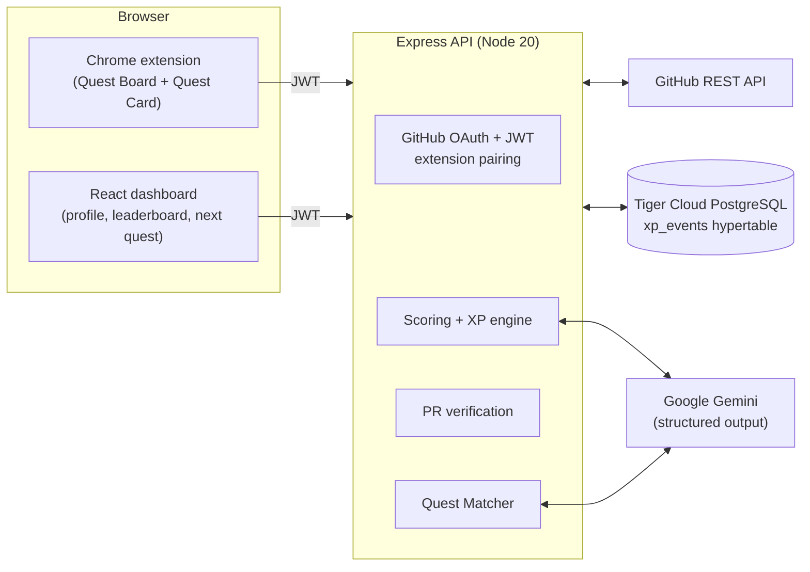

<div align="center">

# GitVenture

**Level up by solving real software problems.**

GitVenture turns live GitHub issues into RPG-style quests, with AI-rated difficulty, XP that has to be earned, a skill tree, and a personalized next-quest curriculum.

🏆 **Built at [HackRice](https://hackrice.com) 2026** at Rice University, Houston, TX


</div>

---

## Why GitVenture

Tutorials teach syntax. LeetCode teaches algorithms. Neither teaches you how to work on **real software**: reading an unfamiliar codebase, scoping a fix, and getting a PR past a maintainer.

Open source is the best training ground for that, but a GitHub issue list is a wall of text with no sense of which issues are approachable, which are worth your time, or what you'll learn from them. GitVenture adds a game layer directly on top of github.com so every issue becomes a quest with a difficulty rating, a skill profile, and a reward that is only paid out when a maintainer approves your work.

## How it works

1. **Sign in with GitHub** on the dashboard and pick a growth goal. GitVenture reads your GitHub history to seed a starter skill tree.
2. **Browse issues on GitHub.** The Chrome extension turns any repository's issue list into a **Quest Board** with an XP badge on every issue.
3. **Open a quest.** A Quest Card shows the XP, required skills, objectives, and difficulty breakdown. Claim it.
4. **Ship a fix.** Open a PR that references the issue (`Closes #123`) and link it on the card. The quest moves to **In review**.
5. **Get verified.** When a maintainer approves or merges the PR, XP unlocks exactly once, followed by a full-screen **Quest Complete** animation with level-ups, skill-ups, and achievements.
6. **Find your next quest.** An AI Quest Matcher recommends the next three issues that best fit your goal and current skills.

## Features

- **Quest Board on github.com.** A Manifest V3 extension injects XP badges into issue lists and a Quest Card into issue pages. It survives GitHub's Turbo (no-reload) navigation.
- **AI-rated difficulty, deterministic XP.** Gemini scores each issue on five axes and returns structured analysis only. The backend computes XP from that analysis, so the model never picks the number.
- **Merge-verified rewards.** Claiming pays nothing. XP is awarded only after the GitHub API confirms that a maintainer approved or merged a PR authored by the claimant.
- **Skill tree and levels.** Every quest carries weighted skills, so completing one levels up the specific skills it exercised.
- **Achievements.** First Blood, Open Source Hero, High Stakes, Polyglot, and Speedrunner.
- **Risk Roll.** Roll a one-time XP multiplier (0.5× to 3×, with a 3× jackpot) on a quest before you take it on. Once rolled, it is locked.
- **Double or Nothing.** After a merge, bank your XP or flip a coin to double it.
- **Global leaderboard and profile.** XP history is charted from a Tiger Data continuous aggregate.
- **Find My Next Quest.** Goal-aware recommendations over curated "worlds" (demo repositories), with a deterministic fallback if the AI is unavailable.

## How XP is calculated

Gemini returns a structured analysis of each issue on five 0–10 axes. GitVenture combines them with fixed weights:

| Axis | Weight |
| --- | --- |
| Technical complexity | 0.35 |
| Scope | 0.20 |
| Codebase context needed | 0.20 |
| Verification difficulty | 0.15 |
| Ambiguity | 0.10 |

```text
difficulty = weighted sum of the five axes   (0–10)
xp         = round(difficulty × 100)         (capped at 1,000)
```

Each score is stored with a `scoring_version`. **An issue is scored once and cached**, so every player sees the same bounty, and editing an issue later can't inflate it.

### Anti-cheat

- **The PR author must be the claimant.** GitVenture checks the PR's author against the signed-in GitHub account.
- **No self-reported completion.** There is no "mark as done" button. The only path to XP is a real PR that a maintainer approves or merges.
- **Idempotent payouts.** XP events are an append-only ledger, and each quest pays out exactly once.
- **Immutable scores.** Cached scores are never re-rolled.

## Architecture



The extension never runs OAuth itself. You sign in on the dashboard, which issues a short-lived pairing code (for example `QUEST-4F2A`) that you paste into the extension popup.

## Tech stack

| Layer | Technology |
| --- | --- |
| Language | TypeScript everywhere (npm workspaces monorepo) |
| Backend | Node 20, Express, `pg` (raw SQL, no ORM), JWT |
| AI | Google Gemini via `@google/genai`, using structured JSON output |
| Database | Tiger Cloud (TimescaleDB on PostgreSQL), with a hypertable and continuous aggregate for XP analytics |
| Dashboard | React 18, Vite, Tailwind CSS, Framer Motion, Lenis |
| Extension | Chrome Manifest V3, vanilla TypeScript |
| Hosting | Render (API web service and static dashboard) |

## Repository layout

```text
GitVenture/
├── packages/
│   ├── server/        # Express API: OAuth, scoring, XP engine, PR verification, migrations
│   ├── dashboard/     # React web app: onboarding, profile, leaderboard, next quest
│   ├── extension/     # Chrome MV3 extension: Quest Board and Quest Card on github.com
│   └── shared/        # Shared types, XP formula, levels, achievements
├── .env.example       # Template for the single root .env
├── render.yaml        # Render deployment blueprint
└── GitVenture_Build_Specs.md   # Original hackathon build spec
```

## Getting started

**Requirements:** Node 20+, a PostgreSQL database (Tiger Cloud recommended), a GitHub OAuth App, and a Gemini API key.

1. **Install dependencies**

   ```bash
   npm install
   ```

2. **Configure the environment.** Copy `.env.example` to `.env` at the **repo root** (there is only one `.env`) and fill it in. See [Environment variables](#environment-variables).

   ```bash
   cp .env.example .env
   ```

3. **Run the database migrations** (once per database)

   ```bash
   npm run migrate
   ```

4. **Build the shared package, seed a demo Quest Board, and start the API and dashboard**

   ```bash
   npm run build -w @gitventure/shared
   npm run seed
   npm run dev
   ```

   The dashboard runs at `http://localhost:5173` and the API at `http://localhost:8787`.

5. **Build and load the extension**

   ```bash
   npm run build -w @gitventure/extension
   ```

   Open `chrome://extensions`, turn on **Developer mode**, click **Load unpacked**, and select `packages/extension/dist`.

6. **Pair the extension.** Sign in on the dashboard, open `/pair`, and paste the one-time code into the extension popup.

### Environment variables

| Variable | Required | Description |
| --- | --- | --- |
| `PORT` | No | API port. Default `8787`. |
| `DATABASE_URL` | Yes | PostgreSQL connection string (Tiger Cloud: `postgres://tsdbadmin:<password>@<service>.<project>.tsdb.cloud.timescale.com:<port>/tsdb?sslmode=require`). |
| `JWT_SECRET` | Yes | Long random string, for example `openssl rand -hex 32`. |
| `API_BASE_URL` | Local default | `http://localhost:8787` |
| `DASHBOARD_URL` | Local default | `http://localhost:5173` |
| `GITHUB_CLIENT_ID` / `GITHUB_CLIENT_SECRET` | Yes | From a [GitHub OAuth App](https://github.com/settings/developers). |
| `GITHUB_OAUTH_CALLBACK` | Local default | `http://localhost:8787/auth/github/callback` |
| `GEMINI_API_KEY` | Yes | From [Google AI Studio](https://aistudio.google.com/apikey). |
| `GEMINI_MODEL` | No | Default `gemini-3.8-flash`. |
| `DEMO_REPOS` | No | Comma-separated `owner/repo` worlds used by Next Quest and `npm run seed`. Default `tejaspalukuri/GitPathDemo`. |
| `GITHUB_TOKEN` | No | Personal access token with `repo` scope, needed to seed private `DEMO_REPOS` before anyone signs in. |
| `ENABLE_DECAY` / `DECAY_PERCENT_PER_DAY` | No | Optional XP decay. Off by default. |

**GitHub OAuth App settings:** set the Homepage URL to `http://localhost:5173` and the Authorization callback URL to `http://localhost:8787/auth/github/callback`. GitVenture requests the `read:user` and `repo` scopes (`repo` is needed to read private repository issues).

### Deployment

`render.yaml` deploys the API as a Render web service and the dashboard as a static site. In production, set `DASHBOARD_URL`, `API_BASE_URL`, and `GITHUB_OAUTH_CALLBACK` to the deployed origins, and set `VITE_API_BASE_URL` and `VITE_DASHBOARD_URL` when building the dashboard and extension. Before publishing the extension, add the production API origin to `packages/extension/public/manifest.json`.

SQL migrations live in `packages/server/src/migrations/`. Migration `004_tiger_xp_analytics.sql` turns `xp_events` into a hypertable and creates the `xp_daily` continuous aggregate behind the profile chart.

## API reference

All routes except auth, health, and the leaderboard require `Authorization: Bearer <jwt>`.

| Area | Endpoints |
| --- | --- |
| Health | `GET /health` |
| Auth | `GET /auth/github`, `GET /auth/github/callback`, `POST /auth/pair/create`, `POST /auth/pair/redeem` |
| Issues | `POST /issues/score`, `GET /issues/:nodeId` |
| Quests | `POST /quests/recommend`, `GET /quests/rolls`, `POST /quests/:issueNodeId/risk-roll` |
| Claims | `POST /claims`, `POST /claims/:id/submit`, `POST /claims/:id/abandon`, `POST /claims/:id/double`, `POST /claims/:id/refresh`, `POST /claims/refresh-mine`, `GET /claims/mine`, `GET /claims/latest-completion` |
| Users | `GET /users/me`, `GET /users/me/timeline`, `GET /users/me/github-signals`, `PUT /users/me/goals` |
| Leaderboard | `GET /leaderboard` |

## Demo walkthrough

1. Sign in at `http://localhost:5173` and pick a growth goal.
2. Click **Find my first quest**, or go to `/next`.
3. Open the demo world at [`tejaspalukuri/GitPathDemo/issues`](https://github.com/tejaspalukuri/GitPathDemo/issues). The issue list becomes a Quest Board.
4. Open a high-XP issue, roll for a multiplier if you want, and claim it from the Quest Card.
5. Open a PR authored by your signed-in account that includes `Closes #<issue>`, then link it on the card. The status changes to **In review**, and no XP is paid yet.
6. Approve or merge the PR as a maintainer, then reopen the card. **Quest Complete** fires and XP is awarded once.
7. Bank the reward or go **Double or Nothing**, then click **Find next quest**.

## Team

GitVenture was built in one weekend at **HackRice 2026** by:

- [Pradyumna Dumane](https://github.com/leo-prad)
- [Raghav Saravanan](https://github.com/raghavsaravanan)
- [Tejas Palukuri](https://github.com/tejaspalukuri)
- [Reventh Sathish Kumar](https://github.com/reventhTheCoder333)

This repository is a fork of the team's original hackathon repo, [leo-prad/HackRice-Project](https://github.com/leo-prad/HackRice-Project).
